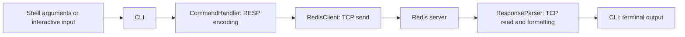

# Redis Client in C++

A small C++17 command-line client built to learn socket programming, RESP2,
and separation of responsibilities.

It connects to an existing Redis server, encodes commands as RESP arrays of bulk
strings, and displays replies in interactive or one-shot mode.

> **Project status:** working educational client for common, valid RESP2
> responses. It is not a production-ready alternative to the official
> `redis-cli`. Input validation, parser hardening, timeouts, automated tests,
> and reliable process exit codes still need work.

## Contents

- [Quick start](#quick-start)
- [Features and boundaries](#features-and-boundaries)
- [Usage](#usage)
- [Project structure](#project-structure)
- [How a command works](#how-a-command-works)
- [What a basic client needs](#what-a-basic-client-needs)
- [Documentation](#documentation)
- [Verification and contribution](#verification-and-contribution)

## Quick start

### Requirements

- C++17 compiler, such as a compatible GCC or Clang.
- CMake 3.16 or newer.
- A build tool supported by CMake, such as Make or Ninja.
- POSIX sockets. Linux is the verified environment; native Windows/Winsock
  support is not implemented. WSL is an appropriate development environment.
- An existing Redis server for end-to-end use.

No third-party C++ library is explicitly linked by the client build.

### Build

From this directory:

```bash
cmake -S . -B build
cmake --build build
```

The executable is `build/redis-client` with the usual single-configuration
Make/Ninja generators. CMake defaults to a Debug build when no configuration is
provided. To request Release:

```bash
cmake -S . -B build -DCMAKE_BUILD_TYPE=Release
cmake --build build
```

### Start a local learning server

If Redis is installed, run the following in a separate terminal. This example
uses port `6380`, listens only on loopback, and disables persistence:

```bash
redis-server --bind 127.0.0.1 --port 6380 --save "" --appendonly no
```

Choose another unused port if necessary. Stop this learning server with
`Ctrl+C` when finished. Do not change or stop an unrelated Redis service.

The experimental [sibling server](../Redis-Server/) is not yet a substitute for
the Redis server used in these examples.

### Run

```bash
./build/redis-client -h 127.0.0.1 -p 6380 PING
./build/redis-client -h 127.0.0.1 -p 6380 ECHO "hello world"
./build/redis-client -h 127.0.0.1 -p 6380
```

Typical one-shot output:

```text
Connected to Redis server.
Socket FD: 3
PONG
```

The socket descriptor is assigned by the operating system and may differ.

## Features and boundaries

| Area | Implemented behavior | Boundary |
|---|---|---|
| Connection | Host/port selection; `getaddrinfo`; tries resolved IPv4/IPv6 addresses | Blocking I/O; no configurable connection/read/write timeouts |
| Commands | Generic RESP encoding; no client-side Redis command whitelist | Availability and argument rules depend on the connected server |
| Interactive mode | Prompt, basic double-quoted arguments, blank-line skipping, local `help`, `quit`, `exit` | Not a full shell parser; no history or completion |
| One-shot mode | Preserves shell-provided argument boundaries; runs once and exits | Connection banners appear on stdout |
| RESP2 replies | Simple strings, errors, integers, bulk strings, arrays, null bulk strings/arrays | Happy-path parsing; malformed/truncated input is not robustly handled |
| Arrays | Recursive element parsing and numbered text output | No typed reply tree; nested formatting is ambiguous |
| Resource cleanup | Destructor closes the connection | Socket-owning class is still implicitly copyable |
| RESP3 | Not implemented | Do not negotiate `HELLO 3` with this client |
| Operations | Manual commands can be sent to a compatible server | No dedicated authentication/TLS/cluster/subscription workflow |

## Usage

```text
redis-client [-h HOST] [-p PORT] [COMMAND [ARG ...]]
```

Defaults: host `127.0.0.1`, port `6379`. Put client options **before** the Redis
command. `-h` means host, not help. There is no implemented `--help` flag.

### Interactive mode

With no command arguments, the client displays a prompt:

```text
127.0.0.1:6380> SET learn:client:name foobar
OK
127.0.0.1:6380> GET learn:client:name
foobar
127.0.0.1:6380> DEL learn:client:name
1
127.0.0.1:6380> GET learn:client:name
(nil)
127.0.0.1:6380> quit
Exiting... goodbye
```

Lowercase `help` currently prints only a placeholder message. Lowercase `quit`
and `exit` are handled locally; end-of-input also exits the loop.

### One-shot mode

```bash
./build/redis-client -p 6380 SET learn:client:greeting "hello world"
./build/redis-client -p 6380 GET learn:client:greeting
./build/redis-client -p 6380 DEL learn:client:greeting
```

Your shell groups `"hello world"` into one argument and removes the surrounding
quotes before the program runs. In interactive mode, the client's own simpler
tokenizer handles double quotes instead.

### Important behavior

- Type Redis commands, not literal RESP samples such as `$6\r\nfoobar\r\n`.
- `-p 1111` selects a destination port; it does not start or reconfigure a server.
- Server errors are displayed with `(Error):`.
- `main()` currently returns `0` after normal control flow even for connection
  failures or Redis error replies. Do not rely on `$?` to identify those failures.
- Commands that switch protocols or require multiple unsolicited replies are
  outside the supported request/reply workflow.

See the [user guide](docs/user-guide.md) for examples and the
[troubleshooting guide](docs/troubleshooting.md) for common failures.

## Project structure

```text
Redis-Client/
|-- CMakeLists.txt           Build target and C++ settings
|-- main.cpp                Process arguments and select execution mode
|-- include/
|   |-- CLI.hpp
|   |-- CommandHandler.hpp
|   |-- RedisClient.hpp
|   `-- ResponseParser.hpp
|-- src/
|   |-- CLI.cpp             Interactive loop and one-shot execution
|   |-- CommandHandler.cpp  Tokenization and RESP command encoding
|   |-- RedisClient.cpp     Socket connection, sending, cleanup
|   `-- ResponseParser.cpp  Socket reads and formatted reply parsing
`-- docs/                   Detailed guides and diagrams
```

The generated `build/` directory is ignored by Git.

## How a command works



For `GET name`, the request is:

```text
*2\r\n$3\r\nGET\r\n$4\r\nname\r\n
```

Here `\r\n` is explanatory notation for actual CR and LF bytes, not text to type
at the prompt. The server executes the command; the client only transports and
displays the result.

## What a basic client needs

Your implementation has the main learning building blocks:

1. Host/port configuration and connection lifecycle.
2. A command represented as a vector of argument strings.
3. RESP command encoding with byte lengths.
4. Sending all command bytes, including ordinary short writes.
5. Dispatching the five core RESP2 response types.
6. Interactive and one-shot interfaces.

Before calling the basic client **reliable**, add strict input/framing validation,
explicit error propagation, bounded reads/allocations/recursion, timeouts,
interrupted-I/O handling, and repeatable tests. See the
[prioritized code assessment](docs/production-readiness.md).

## Documentation

| Document | Audience and purpose |
|---|---|
| [Documentation index](docs/README.md) | Reading order and project boundaries |
| [User guide](docs/user-guide.md) | Installation prerequisites, commands, quoting, output |
| [Architecture](docs/architecture.md) | Component responsibilities, lifecycle, diagrams, design tradeoffs |
| [RESP guide](docs/resp-protocol.md) | Wire formats, current parser behavior, TCP framing |
| [Development and testing](docs/development.md) | Builds, manual checks, proposed automated test matrix |
| [Production readiness](docs/production-readiness.md) | Current code assessment, missing basics, future acceptance criteria |
| [Troubleshooting](docs/troubleshooting.md) | Build, connection, command, and parser problems |

## Verification and contribution

Documentation preparation verified the configure/build commands and representative
client operations against an isolated local Redis instance: `PING`, quoted and
empty `ECHO`, `SET`, `GET`, `EXISTS`, missing keys, `MGET`, unknown-command errors,
`DEL`, interactive help/quit, and end-of-input.

These were ad hoc smoke checks, **not an automated regression suite**. The project
currently has no checked-in client test runner or CTest registration.

Contributions should include focused changes, tests where available, and matching
documentation updates. There is no license file currently provided; see the
[repository overview](../README.md#license).
