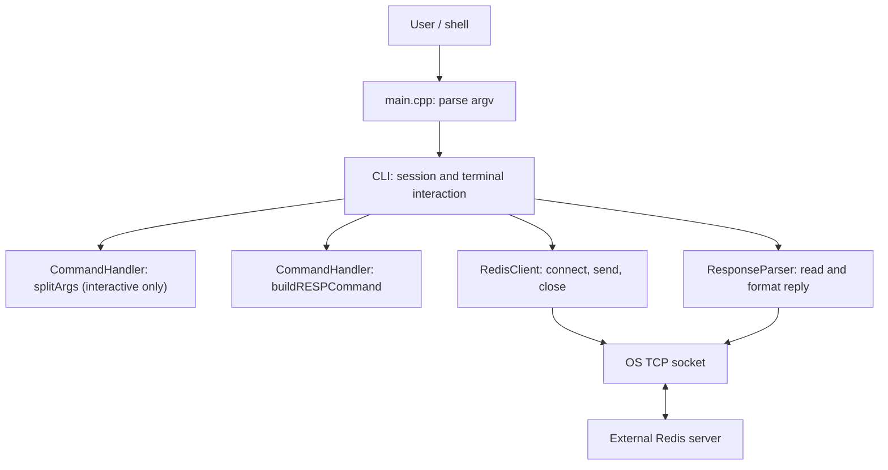
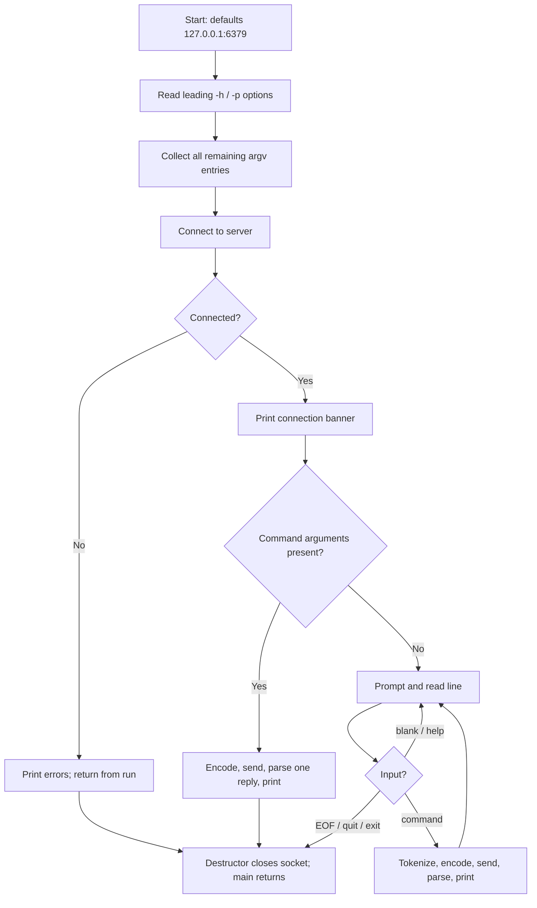
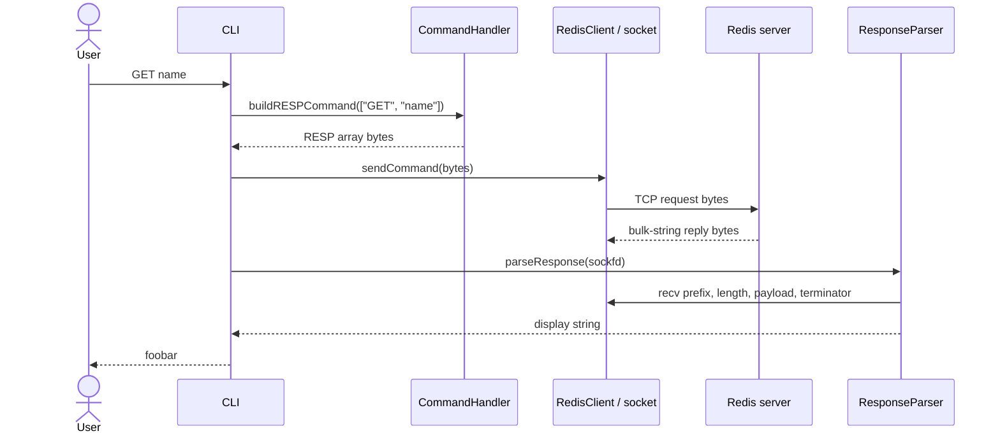

# Architecture and design

[Documentation index](README.md)

## Design goals and current boundaries

The current design separates process configuration, user interaction, request
encoding, networking, and reply parsing. It is synchronous: send one command,
read one reply, then continue.

There is one connection per CLI instance and no worker thread, event loop,
connection pool, pipeline queue, or automatic reconnect.

## Component diagram



`ResponseParser` directly calls `recv()` using the socket descriptor. Networking
is therefore not completely isolated behind `RedisClient`.

## Responsibilities and APIs

| Component | Main API | Responsibility |
|---|---|---|
| [Program entry](../main.cpp) | `main(argc, argv)` | Choose endpoint, collect command arguments, construct CLI |
| [CLI](../include/CLI.hpp) | `run(commandArgs)` | Connect; choose one-shot or interactive mode |
| [CLI](../src/CLI.cpp) | `executeCommand(commandArgs)` | Encode, send, parse, print a one-shot command |
| [CommandHandler](../include/CommandHandler.hpp) | `splitArgs(input)` | Convert an interactive line to arguments |
| [CommandHandler](../src/CommandHandler.cpp) | `buildRESPCommand(args)` | Serialize an array of bulk strings |
| [RedisClient](../include/RedisClient.hpp) | `connectToServer()`, `sendCommand()`, `disconnectFromServer()` | Manage TCP connection and send bytes |
| [ResponseParser](../include/ResponseParser.hpp) | `parseResponse(sockfd)` | Dispatch reply parsing and return display text |

The interactive path currently duplicates encode/send/parse/print rather than
calling `executeCommand()`. A future consolidation should preserve the safer
one-shot behavior of stopping when sending fails.

## Process and argument flow



This diagram shows normal paths. Conversion exceptions, signals, and malformed
protocol input are not uniformly managed by the current implementation.

### Understanding the `else` in the option loop

For `redis-client -p 6380 ECHO "hello world"`:

1. `-p` consumes its next argument as the port.
2. `ECHO` does not match a client option.
3. The `else` collects `ECHO` and `hello world` into `commandArgs`.
4. `break` exits option parsing.
5. The nonempty vector selects one-shot mode.

`argv[i++]` uses the current index and then increments it once. Incrementing it
again inside that loop would skip every other argument.

## Request/reply sequence



TCP can fragment the request/reply into multiple reads or writes. The diagram
does not imply a one-to-one relationship between a RESP message and a TCP packet.

## State and resource ownership

- `main()` owns configuration values until it constructs a `CLI`.
- `CLI` owns a `RedisClient` by value.
- `RedisClient` stores its host, port, and socket descriptor; `-1` means no socket.
- `CLI` also stores host/port for the prompt. These are endpoint configuration,
  not a display of the resolved numeric peer address.
- `connectToServer()` resolves addresses, tries each, closes failed sockets,
  and releases resolver results.
- `sendCommand()` loops to accommodate ordinary partial sends.
- The `RedisClient` destructor calls `disconnectFromServer()`.

This is a useful RAII-style cleanup foundation, but ownership is incomplete:
copying `RedisClient` currently copies the raw descriptor. Delete copy operations
and either define safe move operations or keep the type non-movable before
expanding reuse.

## Data representation

Requests are `std::vector<std::string>` values. Keeping argument boundaries until
encoding avoids splitting values that contain spaces.

Replies are immediately converted to `std::string` display text:

```text
wire reply -> ResponseParser -> formatted string -> stdout
```

This is simple for a learning CLI but loses type information. Simple strings,
integers, and bulk strings can look identical; nulls and literal `(nil)` collide;
nested-array structure is flattened into numbered text.

**Recommended future design, not implemented:**

```text
socket reader -> typed RESP value -> separate terminal renderer
                                -> separate automation renderer
```

Keep that change focused when needed; an event framework or large abstraction
layer is not required to fix basic framing and error handling.

## Error behavior

| Layer | Current behavior |
|---|---|
| Option parsing | `std::stoi` may throw; no structured usage error |
| Connection | Network layer and CLI both print failure messages |
| One-shot send | Print failure and return without parsing |
| Interactive send | Print failure, then still attempt to parse a reply |
| Reply parsing | Mix of returned error-looking strings, unchecked reads, and possible exceptions |
| Process | Normal return from `main()` is always `0` |

See [production readiness](production-readiness.md) for a prioritized path to
consistent results and explicit failure propagation.
